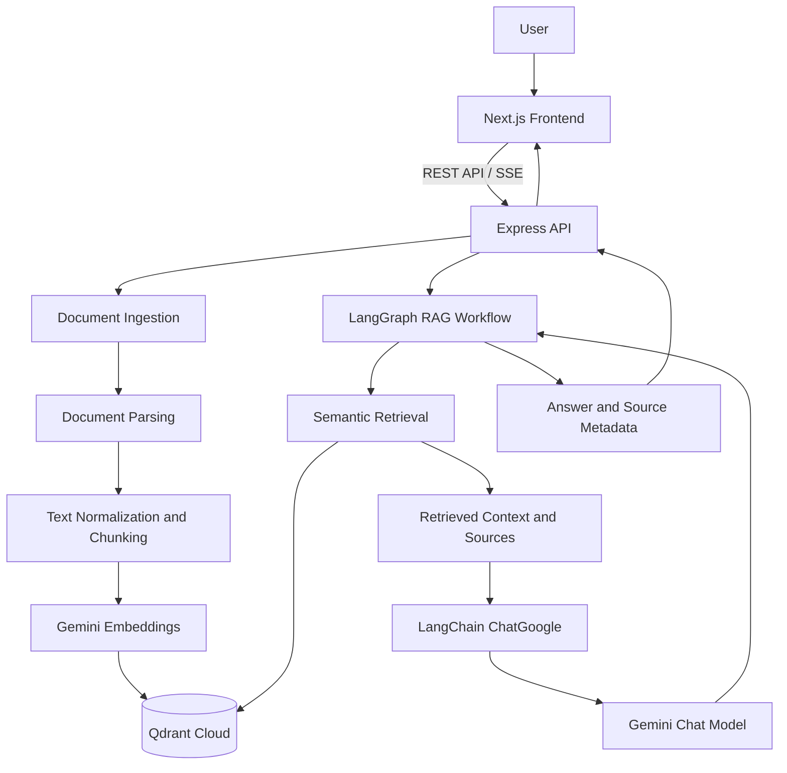

# Document QnA — AI-Powered Document Intelligence

<p align="center">
  <strong>Upload documents. Ask questions. Get context-aware answers.</strong>
</p>

<p align="center">
  A full-stack Retrieval-Augmented Generation (RAG) application built with Next.js, TypeScript, LangChain, LangGraph, Google Gemini, and Qdrant.
</p>

<p align="center">
  
  
  
  
  
</p>

---

## Table of Contents

- [Overview](#overview)
- [Project Goals](#project-goals)
- [Features](#features)
- [Supported Documents](#supported-documents)
- [Technology Stack](#technology-stack)
- [Architecture](#architecture)
- [RAG Pipeline](#rag-pipeline)
- [Project Structure](#project-structure)
- [Prerequisites](#prerequisites)
- [Getting Started](#getting-started)
- [Environment Variables](#environment-variables)
- [Running Locally](#running-locally)
- [Using the Application](#using-the-application)
- [API Documentation](#api-documentation)
- [Vector Database](#vector-database)
- [Configuration and RAG Settings](#configuration-and-rag-settings)
- [Security Considerations](#security-considerations)
- [Known Limitations](#known-limitations)
- [Troubleshooting](#troubleshooting)
- [Deployment](#deployment)
- [Roadmap](#roadmap)
- [Contributing](#contributing)
- [License](#license)

---

## Overview

**Document QnA** is a full-stack document question-answering application that uses Retrieval-Augmented Generation (RAG) to answer questions based on the contents of uploaded documents.

Instead of asking a language model to answer a question using only its general knowledge, Document QnA retrieves relevant chunks from indexed documents and provides that context to the model before generating an answer.

The application combines a custom document-intelligence interface with a RAG backend, vector similarity search, source metadata, and an orchestrated answer-generation workflow.

The goal is to build a maintainable, extensible foundation for a document assistant that can eventually support larger knowledge bases, multiple users, persistent processing jobs, and more advanced retrieval strategies.

### Why Document QnA?

Many document-chat applications offer a basic upload-and-chat experience. This project focuses on both sides of the problem:

- **User experience:** an industrial, pixel-inspired interface with dark/light themes, GSAP animations, document status indicators, and an interactive workspace.
- **Retrieval quality:** document parsing, normalized text, chunking, embeddings, vector search, and context-grounded answer generation.
- **Engineering structure:** a separate frontend and backend, environment configuration, API boundaries, typed models, and independently testable RAG components.

> Project status: Document QnA is an actively developed portfolio project. Some production features remain on the roadmap; see [Known Limitations](#known-limitations).

## Project Goals

The main goals of the project are to:

1. Build a complete RAG application from the ground up.
2. Support several common document formats.
3. Store document chunks as vector embeddings for semantic search.
4. Generate answers grounded in retrieved document content.
5. Return source metadata alongside answers.
6. Orchestrate retrieval and generation through LangGraph.
7. Provide live status updates and streaming chat responses.
8. Keep the architecture suitable for future deployment and extension.

## Features

### User Interface

- Custom Document QnA branding and animated boot intro.
- GSAP-powered interface and loading interactions.
- Light and dark themes.
- Industrial, terminal-inspired visual design.
- Responsive document workspace.
- Document sidebar and active-document selection.
- Chat interface with loading states.
- Retrieval source panel with similarity scores.
- Upload interface with file selection and drag-and-drop support.

### Document Ingestion

- File upload through an Express API.
- File extension validation and upload-size limits.
- Temporary file storage during processing.
- Text extraction from supported documents.
- Document text normalization.
- Recursive character-based chunking.
- Metadata attached to document chunks.
- Gemini embedding generation.
- Qdrant vector indexing.
- Background processing jobs with status polling.

### Retrieval and Answer Generation

- Semantic similarity search using Qdrant.
- Document-specific retrieval using a `documentId` filter.
- Retrieval across the indexed knowledge base.
- Configurable retrieval limits within the API's supported range.
- LangGraph-based answer workflow.
- Gemini-powered answer generation through LangChain.
- An insufficient-context branch intended to reduce unsupported answers.
- Source metadata returned to the frontend.
- Server-Sent Events (SSE) for streaming chat responses.

### Document Management

- Persistent document listings reconstructed from indexed Qdrant payloads.
- Document metadata including filename, type, size, and chunk count.
- Document deletion by ID.
- Sidebar refresh after indexing.
- Active-document selection for document-scoped questions.

## Supported Documents

The current implementation includes parsers for the following formats:

| Format | Parser | Current behavior |
|---|---|---|
| PDF | `pdf-parse` | Text extraction with page-level metadata for text-based PDFs |
| DOCX | Mammoth | Raw text extraction |
| XLSX | SheetJS | Worksheet conversion into searchable text |
| XLS | SheetJS | Legacy spreadsheet parsing |
| TXT | Node.js file handling | UTF-8 text extraction |
| DOC | Not yet supported end-to-end | Convert legacy Word files to DOCX before uploading |

### Important document limitations

- Image-only or scanned PDFs require OCR, which is not currently implemented.
- Page-level citations depend on successful page-aware PDF extraction.
- Spreadsheet extraction converts worksheet data into text; complex workbook semantics, formulas, charts, and formatting may not be fully preserved.
- Password-protected or malformed files may fail during parsing.

The supported file extensions in the UI do not guarantee that every document can be successfully extracted. Parser-level validation remains authoritative.

## Technology Stack

| Layer | Technologies |
|---|---|
| Frontend framework | Next.js, React |
| Programming language | TypeScript |
| Styling | Tailwind CSS v4 |
| Animation | GSAP |
| Icons | Lucide React |
| Backend runtime | Node.js |
| API framework | Express |
| Validation | Zod |
| Upload handling | Multer |
| Document processing | `pdf-parse`, Mammoth, SheetJS |
| Text chunking | LangChain Text Splitters |
| AI integration | Google Gemini API |
| Chat model integration | LangChain `ChatGoogle` |
| RAG orchestration | LangGraph |
| Embedding generation | Gemini embedding model |
| Vector database | Qdrant Cloud |
| Package manager | pnpm |
| Source control | Git and GitHub |

Model IDs are configured in the backend code and may need to be updated if model availability changes or a Google API project does not have access to the configured models.

## Architecture

Document QnA uses a monorepo with separate frontend and backend applications.



### Component responsibilities

**Next.js frontend**

Handles the interface, upload controls, theme preferences, selected-document state, chat messages, retrieval sources, and streaming response rendering.

**Express backend**

Provides API endpoints for uploads, processing jobs, document management, retrieval, and chat. The backend is responsible for keeping Gemini and Qdrant credentials out of browser code.

**LangChain**

Provides integrations for the Gemini chat model and document text splitting.

**LangGraph**

Coordinates the RAG workflow, including retrieval, relevance-based branching, answer generation, and source assembly.

**Gemini API**

Generates document embeddings and answers based on retrieved context.

**Qdrant Cloud**

Stores vector embeddings and chunk payload metadata, allowing the application to find semantically relevant passages.

## RAG Pipeline

### 1. Document ingestion

```text
User uploads a document
          |
          v
Express validates the upload
          |
          v
Document is temporarily stored
          |
          v
Parser extracts text
          |
          v
Text is normalized
          |
          v
Text is split into chunks
          |
          v
Gemini generates embeddings
          |
          v
Vectors and metadata are stored in Qdrant
          |
          v
Document becomes searchable
```

Each chunk can include metadata such as:

- `documentId`
- `documentName`
- `fileType`
- `chunkIndex`
- `pageNumber`
- `sheetName`
- `source`
- `content`

Some fields are format-dependent. For example, PDF chunks may have page numbers, while spreadsheet chunks may have worksheet names.

### 2. Question answering

```text
User asks a question
          |
          v
Express validates the request
          |
          v
LangGraph starts the RAG workflow
          |
          v
Question is embedded
          |
          v
Qdrant searches relevant chunks
          |
          v
Retrieved context is evaluated
          |
          +---- Insufficient context
          |          |
          |          v
          |     Return a not-found response
          |
          +---- Sufficient context
                     |
                     v
              Build the model prompt
                     |
                     v
              Gemini generates an answer
                     |
                     v
              Attach source metadata
                     |
                     v
              Return answer to frontend
```

### 3. Source attribution

Retrieved chunks contain source metadata that the application can display in the source panel.

For example:

```text
Source: annual-report.pdf
Page: 14
Chunk: 7
Similarity: 0.91
```

Similarity scores rank retrieved chunks; they should not be interpreted as calibrated probabilities that an answer is correct.

## Project Structure

The repository is organized as a pnpm workspace.

```text
Document-Q-A/
│
├── apps/
│   ├── web/
│   │   ├── app/
│   │   │   ├── page.tsx
│   │   │   ├── layout.tsx
│   │   │   └── globals.css
│   │   │
│   │   ├── components/
│   │   │   ├── intro/
│   │   │   ├── upload/
│   │   │   └── workspace/
│   │   │
│   │   ├── lib/
│   │   │   └── api.ts
│   │   ├── types/
│   │   ├── public/
│   │   ├── .env.example
│   │   └── package.json
│   │
│   └── server/
│       ├── src/
│       │   ├── config/
│       │   ├── controllers/
│       │   ├── middleware/
│       │   ├── rag/
│       │   ├── routes/
│       │   ├── services/
│       │   ├── types/
│       │   ├── app.ts
│       │   └── server.ts
│       │
│       ├── .env.example
│       └── package.json
│
├── docs/
├── packages/
├── .gitignore
├── package.json
├── pnpm-lock.yaml
├── pnpm-workspace.yaml
└── README.md
```

Some directories may contain additional files as development continues. Only tracked files are included in the GitHub repository; empty directories are not retained by Git.

## Prerequisites

Before running the project, install:

- **Node.js:** a current supported LTS release compatible with the installed Next.js and document-parser dependencies.
- **pnpm:** version compatible with the root `packageManager` field; this project was initialized with pnpm 10.
- **Git:** for cloning and source control.
- **Google Gemini API key:** for model access.
- **Qdrant Cloud account and cluster:** for remote vector storage.

Docker is **not required** for this setup. The vector database is hosted in Qdrant Cloud.

Official resources:

- [Node.js](https://nodejs.org/)
- [pnpm](https://pnpm.io/installation)
- [Google AI Studio](https://aistudio.google.com/)
- [Gemini API documentation](https://ai.google.dev/gemini-api/docs)
- [Qdrant Cloud](https://cloud.qdrant.io/)
- [Qdrant documentation](https://qdrant.tech/documentation/)

## Getting Started

### 1. Clone the repository

```bash
git clone https://github.com/MdFaisalAlam-dev/Document-Q-A.git
cd Document-Q-A
```

### 2. Install dependencies

Run this command from the repository root:

```bash
pnpm install
```

Use the root lockfile to keep dependency versions consistent across the workspace.

### 3. Configure backend environment variables

Copy the example environment file.

In Windows PowerShell:

```powershell
Copy-Item apps/server/.env.example apps/server/.env
```

On macOS or Linux:

```bash
cp apps/server/.env.example apps/server/.env
```

Open `apps/server/.env` and provide your actual Gemini and Qdrant credentials. See [Environment Variables](#environment-variables).

### 4. Configure frontend environment variables

In Windows PowerShell:

```powershell
Copy-Item apps/web/.env.example apps/web/.env.local
```

On macOS or Linux:

```bash
cp apps/web/.env.example apps/web/.env.local
```

The frontend should use the local Express API during local development.

### 5. Verify the backend

```bash
pnpm --filter server typecheck
```

The command should complete without TypeScript errors.

### 6. Verify the frontend

```bash
pnpm --filter web build
```

The frontend should finish its production build successfully.

## Environment Variables

### Backend: `apps/server/.env`

Use the following configuration as a reference:

```env
NODE_ENV=development
PORT=3001
FRONTEND_URL=http://localhost:3000

GEMINI_API_KEY=your_gemini_api_key

QDRANT_URL=https://your-qdrant-cluster-url
QDRANT_API_KEY=your_qdrant_api_key
```

| Variable | Purpose |
|---|---|
| `NODE_ENV` | Runtime environment |
| `PORT` | Express server port; defaults to `3001` in the local configuration |
| `FRONTEND_URL` | Allowed frontend origin for CORS |
| `GEMINI_API_KEY` | Secret key for Gemini API access |
| `QDRANT_URL` | Qdrant Cloud cluster URL |
| `QDRANT_API_KEY` | Secret key for Qdrant authentication |

Use the exact cluster URL supplied by Qdrant Cloud.

### Frontend: `apps/web/.env.local`

```env
NEXT_PUBLIC_API_URL=http://localhost:3001
```

`NEXT_PUBLIC_API_URL` identifies the API the browser calls.

This variable is public and must not contain credentials. Next.js embeds public environment variables into client-side bundles at build time, so the frontend must be rebuilt after changing the API URL used for production.

### Environment variable rules

- Never commit real `.env` or `.env.local` files.
- Keep real API keys on the backend.
- Commit only the example environment files with empty secret values.
- Restart the relevant development server after changing its environment variables.

## Running Locally

Run each application in a separate terminal.

### Terminal 1 — Express backend

From the repository root:

```bash
pnpm --filter server dev
```

Expected local API URL:

```text
http://localhost:3001
```

Health endpoint:

```text
http://localhost:3001/health
```

### Terminal 2 — Next.js frontend

From the repository root:

```bash
pnpm --filter web dev
```

Open:

```text
http://localhost:3000
```

The frontend communicates with the Express server through the API URL configured in `apps/web/.env.local`.

### Useful development commands

```bash
# Run the frontend
pnpm --filter web dev

# Run the backend
pnpm --filter server dev

# Type-check the backend
pnpm --filter server typecheck

# Build the backend
pnpm --filter server build

# Build the frontend
pnpm --filter web build
```

## Using the Application

### 1. Start the application

Start both the Express backend and Next.js frontend.

### 2. Upload a document

Open the workspace and select **Upload Document**. Select a supported file, then start processing.

The frontend sends the file to the backend ingestion endpoint.

### 3. Wait for indexing

The ingestion workflow extracts text, generates chunks, requests embeddings, and writes vectors to Qdrant.

The processing interface polls the backend job endpoint for status updates.

### 4. Select a document or search the full knowledge base

Select an individual document to scope retrieval to that document, or choose **All Documents** to search across indexed documents.

### 5. Ask a question

Enter a question about the indexed content.

The application retrieves relevant chunks, invokes the RAG workflow, and returns an answer along with source metadata.

### 6. Inspect sources

Use the source panel to inspect the chunks returned by retrieval, including available document, page, worksheet, and similarity information.

### 7. Delete an indexed document

Use the delete control in the document sidebar to remove the document's indexed chunks from Qdrant.

## API Documentation

The Express API runs at:

```text
http://localhost:3001
```

The endpoints below describe the intended behavior of the current implementation. Error responses and exact response fields may vary by endpoint.

### Health and AI services

| Method | Endpoint | Purpose |
|---|---|---|
| GET | `/` | Basic API information |
| GET | `/health` | Check whether the backend is running |
| GET | `/ai/status` | Test Gemini and Qdrant connectivity |
| GET | `/ai/vector-stats` | Inspect vector collection statistics |

Note: `/ai/status` may call Gemini to verify model connectivity, so it can consume API quota.

### Documents

| Method | Endpoint | Purpose |
|---|---|---|
| GET | `/documents` | List documents reconstructed from indexed chunks |
| POST | `/documents/upload` | Upload and temporarily store a file without indexing it |
| POST | `/documents/process` | Start document ingestion and return a processing job |
| GET | `/documents/jobs/:jobId` | Get processing-job status |
| DELETE | `/documents/:documentId` | Delete indexed chunks for a document |

#### Upload and process a document

Send a `multipart/form-data` request to:

```text
POST /documents/process
```

The form field must be named `file`.

Example with curl:

```bash
curl -X POST \
  http://localhost:3001/documents/process \
  -F "file=@./test.txt"
```

The background-job endpoint is designed to return `202 Accepted` with a job ID. Use the returned ID to poll:

```text
GET /documents/jobs/:jobId
```

A job may report stages such as `received`, `extracting`, `chunking`, `embedding`, `indexing`, `ready`, or `failed`.

### Retrieval

| Method | Endpoint | Purpose |
|---|---|---|
| POST | `/retrieval/search` | Perform semantic vector retrieval |

Example request:

```json
{
  "question": "What is this document about?",
  "limit": 5
}
```

To restrict retrieval to one document:

```json
{
  "question": "What does this document say about embeddings?",
  "documentId": "doc_your_document_id",
  "limit": 5
}
```

The `documentId` filter is optional. The supported API range for the retrieval limit is 1–10.

### Chat

| Method | Endpoint | Purpose |
|---|---|---|
| POST | `/chat/query` | Run RAG and return a complete JSON answer |
| POST | `/chat/stream` | Run RAG and stream status, source, and answer events using SSE |

#### JSON chat example

```json
{
  "question": "What is Qdrant used for?",
  "limit": 5
}
```

#### Streaming chat example

```json
{
  "question": "Summarize the important points in this document.",
  "limit": 5
}
```

The streaming endpoint responds with Server-Sent Events. Depending on the result, events can include:

- `status`: current retrieval or generation stage
- `sources`: retrieved source metadata
- `token`: a generated answer fragment
- `complete`: final answer and source information
- `error`: an error encountered during processing

The endpoints accept the optional `documentId` field for document-scoped retrieval.

## Vector Database

Document QnA uses **Qdrant Cloud** to store embeddings and searchable payload metadata.

The collection used by the current ingestion implementation is:

```text
document_qna_chunks
```

The vector collection is created by the backend if it does not already exist when indexing a document.

The current embedding implementation requests 768-dimensional vectors and configures the collection for cosine similarity. Keep the embedding model, output dimensions, and collection configuration consistent. If the embedding model or dimensions change, existing vectors may need to be re-indexed into a compatible collection.

### Example payload

```json
{
  "documentId": "doc_example",
  "documentName": "annual-report.pdf",
  "content": "Example extracted document text...",
  "chunkIndex": 7,
  "fileType": ".pdf",
  "pageNumber": 14,
  "sheetName": null,
  "source": "annual-report.pdf / Page 14"
}
```

The payload allows the application to associate retrieved vectors with their source documents.

### Document listing and deletion

The current document registry is reconstructed from indexed Qdrant point payloads. This avoids requiring another database for the initial portfolio version.

Deleting a document removes points whose payload matches the given `documentId`.

This is suitable for a small-scale demonstration. Larger installations should keep authoritative document metadata in a dedicated database.

## Configuration and RAG Settings

The current code uses these initial settings:

| Setting | Current configuration |
|---|---|
| Text chunking | Recursive character text splitting |
| Chunk size | 1,000 characters |
| Chunk overlap | 150 characters |
| Retrieval limit | Default 5, capped at 10 |
| Embedding output dimensions | 768 |
| Vector distance | Cosine |
| Chat model | `gemini-2.5-flash` |
| Embedding model | `gemini-embedding-2` |
| Vector collection | `document_qna_chunks` |

These are initial development defaults, not universal best settings. Tune chunking and retrieval based on representative documents and measured answer quality.

Model availability and API limits depend on the Google AI project, account, and current Gemini API offering. Check the official model documentation before changing model IDs.

## Security Considerations

Document QnA is a development and portfolio project, not a fully hardened multi-user document platform.

Before deploying it for public or sensitive use:

- Never commit Gemini or Qdrant API keys.
- Keep secrets in backend environment variables.
- Keep `.env`, `.env.local`, uploaded documents, logs, and generated files out of Git.
- Validate file extensions and enforce upload-size limits.
- Add authentication and authorization before allowing users to access private documents.
- Add request rate limits and resource quotas to reduce abuse and unexpected API usage.
- Treat document text as untrusted content when building prompts.
- Review how your AI provider handles submitted text before indexing confidential documents.
- Add appropriate request timeouts and robust error handling for external API calls.
- Use HTTPS and restrict production CORS to your actual frontend origin.

The frontend should never call Gemini or Qdrant directly using a private API key.

## Known Limitations

The following limitations are important when running or deploying the current version.

### 1. Processing jobs are in memory

The processing-job registry currently uses an in-memory map.

If the Express process restarts while a job is running, that job's status can be lost. The application does not yet have a durable queue or persistent job table.

### 2. Document metadata is reconstructed from Qdrant

The document listing is derived from stored chunk payloads. This is not equivalent to a dedicated relational document registry, and a document that produces no indexed chunks cannot be reliably listed through that mechanism.

### 3. Temporary file storage

Uploaded files are stored temporarily while the backend processes them and are deleted after processing completes or fails. The application does not provide permanent original-file storage.

### 4. No OCR yet

Scanned PDFs and images without a usable text layer require OCR. That is not part of the current pipeline.

### 5. Legacy Word documents

Legacy binary `.doc` parsing is not enabled end-to-end. Convert those files to `.docx` before uploading.

### 6. No complete authentication system

The project does not yet implement a full account system, document ownership, or multi-tenant access controls.

### 7. Retrieval scores require evaluation

Similarity scores are rankings, not calibrated confidence values. A high score does not guarantee that the retrieved text supports every statement in an answer.

### 8. Streaming and external API failures

Streaming requests can fail because of network issues, API limits, service restarts, or model errors. The application should be tested against these failures before production use.

## Troubleshooting

### Backend does not start

Check that `apps/server/.env` exists and that all required environment variables are configured.

Run:

```bash
pnpm --filter server typecheck
```

Review the terminal output for TypeScript errors.

### Frontend cannot connect to Express

Check:

```env
NEXT_PUBLIC_API_URL=http://localhost:3001
```

Also check that Express is running and that its `FRONTEND_URL` matches the browser origin.

Restart the servers after environment changes.

### Gemini requests fail

Check the API key, configured model IDs, project access, and usage limits. Review the backend terminal for the original error.

### Qdrant requests fail

Confirm that `QDRANT_URL` is the correct cluster URL and that `QDRANT_API_KEY` belongs to that cluster.

Ensure the Qdrant cluster is active.

### The vector statistics endpoint fails before the first upload

The collection may not exist yet. Process a small supported text document first so the backend creates the collection and inserts vectors.

### A document cannot be parsed

Try a small, text-based sample file. If the file is a scanned PDF, an unsupported legacy Word file, password protected, malformed, or empty, extraction may fail.

### A job disappears

The job registry is in memory. If the backend restarted, an active job may no longer be present. Restart the ingestion request after confirming that the uploaded file and vector index are in a consistent state.

### Answers do not cite the expected content

Inspect the output of `/retrieval/search`. If the retrieved chunks do not contain the relevant information, review chunking, embeddings, the selected-document filter, and retrieval limits before changing the answer-generation prompt.

## Deployment

Document QnA is designed around a deployment-friendly separation between the frontend, backend, AI provider, and vector database.

A possible deployment architecture is:

| Component | Example hosting target |
|---|---|
| Next.js frontend | Vercel |
| Express backend | Render or another Node-compatible host |
| AI model and embeddings | Google Gemini API |
| Vector database | Qdrant Cloud |

The deployed frontend needs a public API base URL, while the backend needs its Gemini and Qdrant credentials as environment variables.

Before production deployment:

1. Verify that the frontend build and backend build pass.
2. Configure the production `NEXT_PUBLIC_API_URL`.
3. Set the backend `FRONTEND_URL` to the deployed frontend origin.
4. Configure backend secrets in the hosting provider.
5. Test health checks, indexing, job polling, retrieval, and streaming chat.
6. Review the free-tier limits of each provider.

Free hosting is useful for portfolio demos, but cold starts, service restarts, API quotas, and free-tier resource limits can affect the experience. In-memory processing jobs are particularly vulnerable to backend restarts.

## Roadmap

- [x] Next.js and Express monorepo foundation
- [x] Custom animated intro and workspace
- [x] Light and dark themes
- [x] Document upload foundation
- [x] Text extraction and chunking for supported document types
- [x] Gemini embedding integration
- [x] Qdrant vector indexing
- [x] Semantic retrieval
- [x] LangChain and LangGraph answer workflow
- [x] Document-scoped retrieval
- [x] Document listing and deletion using Qdrant payloads
- [x] Processing-job status polling
- [x] Streaming chat API and frontend integration
- [x] Page-aware PDF processing implementation
- [ ] Full legacy `.doc` support
- [ ] OCR for scanned PDFs
- [ ] Durable processing jobs and background worker
- [ ] PostgreSQL-backed document registry
- [ ] Authentication and document ownership
- [ ] Hybrid keyword and semantic retrieval
- [ ] Retrieval evaluation and automated tests
- [ ] Observability and production rate limits
- [ ] Verified production deployment

## Contributing

Contributions, improvements, bug reports, and suggestions are welcome.

If you want to contribute:

1. Fork the repository.
2. Create a branch for your changes.
3. Keep frontend, backend, and shared concerns separated.
4. Run the relevant type-check and build commands.
5. Test the affected API or interface behavior.
6. Submit a pull request with a clear description of the change.

Please don't include API keys, private documents, or `.env` files in pull requests.

## License

No license has been specified in this README. If you want other developers to reuse, modify, and redistribute the project, add an explicit license file to the repository.

The MIT License is one option for a permissive open-source project. If you choose MIT, add the standard MIT `LICENSE` file at the repository root before describing the project as MIT-licensed.
